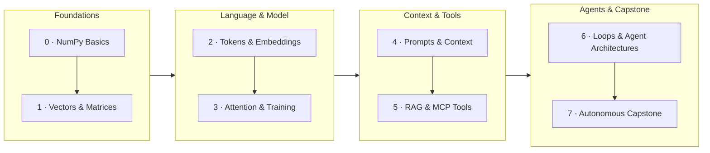

# How AI Works: From Math to Multi-Agent Systems

A hands-on course that teaches how artificial intelligence really works — from the
linear algebra underneath it all the way up to autonomous multi-agent systems.
It's written for high-school students with a little Python and linear algebra, but
anyone curious about what happens inside a Large Language Model is welcome.

Every lesson pairs plain-English explanations with small, runnable `numpy`
examples, verified output, and exercises with worked solutions. The same math
that processes a 3-element vector is the math inside the largest models in the
world — so we learn it on toy examples you can run yourself.

[Start Lesson 1.1: Vectors :octicons-arrow-right-24:](module-01-math/1.1-vectors.md){ .md-button .md-button--primary }
[Module 0: Readiness Check :octicons-tools-16:](module-00-setup/0.1-readiness-check.md){ .md-button }
[For Educators :octicons-mortar-board-16:](educators.md){ .md-button }

---

## How to use this course

- **Read in order.** Each module builds on the last; the math in Module 1 powers
  everything that follows.
- **Run the code anywhere.** Click the **"Run in Browser"** button to execute Python code instantly on this page (via Pyodide), or click **"Open in Colab"** for a full notebook environment.
- **Do the exercises.** Every lesson ends with hands-on exercises and collapsible
  solutions. Try them before peeking!
- **Track your progress.** Use the **"Mark as Complete ✓"** button at the bottom of each lesson to track your journey in the sidebar.
- **Hover to inspect terms.** Key AI terms are automatically underlined across all lessons—hover your cursor over any underlined term for an instant definition, or visit the [Glossary](glossary.md).

---

## The Roadmap

### AI Architecture Map



### Course Modules

<div class="grid cards" markdown>

-   :material-check-decagram:{ .lg .middle } **Module 0: Readiness Check**

    ---

    *Estimated time: ~45 mins*

    Brush up on Python lists vs. NumPy arrays, `.shape`, array indexing, slicing, and broadcasting basics.

    [:octicons-arrow-right-16: Start Module 0](module-00-setup/0.1-readiness-check.md)

-   :material-calculator:{ .lg .middle } **Module 1: The Math Behind the Magic**

    ---

    *Estimated time: ~2.5 hours*

    Vectors, dot products, matrices, matrix-vector multiplication, and how they become artificial neurons.

    [:octicons-arrow-right-16: Explore Module 1](module-01-math/1.1-vectors.md)

-   :material-book-alphabet:{ .lg .middle } **Module 2: How AI Understands Text**

    ---

    *Estimated time: ~2 hours*

    Tokenization, word embeddings, vector space geometry, and cosine similarity.

    [:octicons-arrow-right-16: Explore Module 2](module-02-text/2.1-tokenization.md)

-   :material-brain:{ .lg .middle } **Module 3: Inside the Large Language Model**

    ---

    *Estimated time: ~3 hours*

    The Transformer architecture, self-attention, layer-by-layer representations, next-token prediction, loss, and gradients.

    [:octicons-arrow-right-16: Explore Module 3](module-03-llm/3.1-llm-structure.md)

-   :material-message-text:{ .lg .middle } **Module 4: The Art and Science of Context**

    ---

    *Estimated time: ~1.5 hours*

    Prompt anatomy, system prompts, context windows, and automated prompt pipelines.

    [:octicons-arrow-right-16: Explore Module 4](module-04-context/4.1-anatomy-of-a-prompt.md)

-   :material-database-search:{ .lg .middle } **Module 5: Expanding the AI's Brain**

    ---

    *Estimated time: ~2.5 hours*

    Memory limits, hallucination, Retrieval-Augmented Generation (RAG), dynamic context, and Model Context Protocol (MCP).

    [:octicons-arrow-right-16: Explore Module 5](module-05-rag-tools/5.1-limits-of-memory.md)

-   :material-robot:{ .lg .middle } **Module 6: The Evolution of AI Architectures**

    ---

    *Estimated time: ~2.5 hours*

    From simple stateless chat to reasoning loops (Chain-of-Thought), tool calling, autonomous agents, and multi-agent systems.

    [:octicons-arrow-right-16: Explore Module 6](module-06-evolution/6.1-simple-chat.md)

-   :material-rocket-launch:{ .lg .middle } **Module 7: Capstone Projects**

    ---

    *Estimated time: ~3 hours*

    Assemble everything: build a Mini RAG Chatbot from scratch (7.1), then upgrade it into an autonomous Agent with tools (7.2).

    [:octicons-arrow-right-16: Explore Module 7](module-07-capstone/7.1-mini-rag-chatbot.md)

</div>

---

/// info | For Educators & Teachers
Teaching high-school AP Computer Science, a college seminar, or a coding club? Check out our [**Educator Guide & Classroom Resources**](educators.md) for curriculum pacing, standards alignment (CSTA & AP CSP), and autograded assignment templates.
///

---

## Running locally

You only need Python and `numpy`:

```bash
pip install numpy
```

Then open any notebook in the `notebooks/` folder, or copy a lesson's code into a
Python file. To build and preview the site itself, see
[CONTRIBUTING](https://github.com/bzenowich/learnai/blob/main/CONTRIBUTING.md).

---

*This course is open source. Prose and lessons are licensed
[CC BY 4.0](https://github.com/bzenowich/learnai/blob/main/LICENSE-CONTENT);
code samples are licensed [MIT](https://github.com/bzenowich/learnai/blob/main/LICENSE).*
